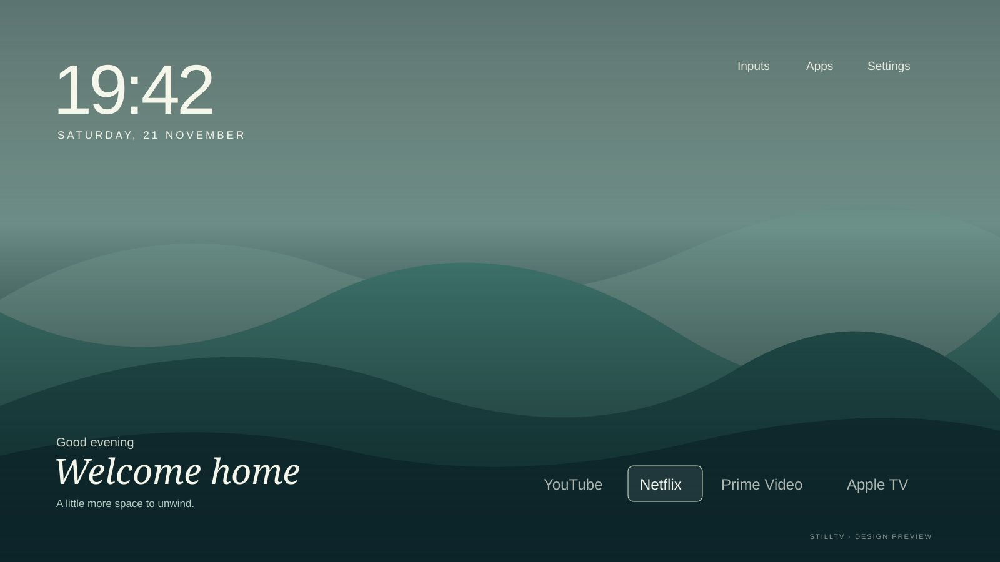

# StillTV

**Your screen. Your photos. A quieter home.**

A native, offline Android TV home and a Python CLI for **device-bound, reviewable, recoverable**
customization. No cloud account. No analytics. No root. No firmware flashing.



> **Early public MVP, not a universal TV optimizer.** The Android APK compiles; the management layer
> has failure-injection tests. Hardware compatibility and physical remote behavior must be checked
> per device. See the [verification record](docs/verification.md). No speed or RAM improvement over
> another launcher has been benchmarked.

## What you get

- **An actual launcher**, not just an agent prompt: a large clock, greeting, configurable text-only
  favorites, app library and discovered HDMI inputs. Three modes: cinematic, quiet and high contrast.
- **Local photo Home and screensaver.** A local processor contains the whole photo inside safe zones,
  strips EXIF, and generates separate Home/screensaver frames. No cloud photo processing or face API.
- **Inspect → plan → approve → apply → restore.** Plans bind to stable hardware identity and a package/
  Home/accessibility snapshot. Stale plans and wrong-device recovery are refused.
- **Write-ahead recovery.** Changes are journaled before execution, verified afterwards, and compensated
  on failure. A lost acknowledgement is not assumed to mean that nothing changed.
- **Per-device isolation.** Manufacturer/model profiles, per-device locks, private state directories and
  explicit serials. You can reuse a reviewed profile; you cannot reuse a plan on another TV.
- **No wholesale debloat.** Android, Google, input, setup, update, remote, casting, keyboard, current Home
  and accessibility components are protected. There is no `--force` escape hatch. The Sony profile
  disables **nothing by default**.

The launcher requests **zero Android permissions** and has **no INTERNET permission**. Its configuration
provider is writable only by privileged callers such as the authorized ADB shell. Photos stay in
app-private storage. A favorite streaming app may, of course, use its own network connection.

## Quick start

You need Python 3.11+, Android platform-tools (`adb`), an Android/Google TV on API 26+, and the remote
nearby. Samsung Tizen, LG webOS, Roku, VIDAA and Fire TV Home takeover are **not supported**.

```bash
git clone https://github.com/Ishaan1342/stilltv.git
cd stilltv
python3 -m venv .venv
# Windows: .venv\Scripts\activate
source .venv/bin/activate
python -m pip install '.[photos]'

# Enable debugging on the TV and authorize this computer on its screen first.
adb connect <tv-host>:5555
stilltv --device <adb-serial> inspect
```

`inspect` is read-only but its output contains private device/app information. Do not post it publicly.
This tool does not scan a subnet, accept all pairing prompts or automatically discover/control TVs.

### Build and open the launcher

Follow [the reproducible build guide](docs/build.md): JDK 17 and SDK platform/build-tools 34, no Gradle
or third-party Android runtime libraries. APKs use your local development key; **keys and APKs are not
committed**. A published source tree is not an app-store release or a reproducible signing identity.

```bash
python tools/build_android.py
stilltv --device <adb-serial> install --apk build/android/stilltv.apk

# Opens it once. This interrupts the current on-screen content, so choose a good moment.
stilltv --device <adb-serial> open
```

Installation does **not** change Home, disable your launcher, grant accessibility access or start the
screensaver. Missing favorite apps are skipped; the full installed TV app library remains accessible.

### Your photos and configuration

Keep photos and per-person configs **outside all Git checkouts**. The CLI refuses private output in a
Git working tree, including the enclosing assistant workspace. Photo input/output must be different,
non-nested directories. Originals are never edited.

```bash
stilltv photos --source /path/to/originals --out /path/to/prepared
```

Copy `android/assets/config.json` to a private directory. Set `name`, `theme`, favorites and the `photos`
array from the generated `photos.json`. Captions are empty unless you supply them; no location guesses.

```bash
stilltv --device <adb-serial> configure --config /private/home.json --photos /path/to/prepared
stilltv --device <adb-serial> open
```

Configuration is staged and validated before an atomic commit. A failed commit keeps the existing
configuration. **This is not face detection:** preserving the complete foreground avoids cropping
heads regardless of detector accuracy. The tradeoff is a framed-photo appearance. Darker images are
preferred at night when available. Full-frame immersive face-aware crops are not implemented.

When ready, make it Home explicitly:

```bash
stilltv --device <adb-serial> activate --confirm-home-change
# If an existing Projectivy Home override intercepts the button, explicitly opt into pausing only it:
stilltv --device <adb-serial> activate --confirm-home-change --pause-projectivy
# Use the journal path returned by that operation to recover:
stilltv --device <adb-serial> restore-home --journal /private/state/device/home-run.json
```

The stock launcher remains installed and enabled. Failed handover restores its preference. Other
accessibility services are preserved. Physical remote verification is still required: an injected
Home key is **not** proof that a hardware-specific remote works. Select **StillTV Photos** manually in
Android's Screen saver settings; the CLI does not silently replace an existing screensaver.

### Optional, reviewed package cleanup

This is separate from getting an ad-free Home. Use a profile for the **exact TV**, inspect each candidate
with `adb -s <adb-serial> shell dumpsys package <package>`, and provide a specific reason. Do not copy
another household's package list. `profiles/example.json` is synthetic and not a recommendation.

```bash
stilltv --device <adb-serial> plan --profile profiles/sony-android12.json --out /private/plan.json
# Read the complete plan; use its exact approval SHA-256, not "yes".
stilltv --device <adb-serial> apply --plan /private/plan.json --approve <full-plan-sha256>
stilltv --device <adb-serial> restore --journal /private/state/device/plan/journal.json
```

State defaults to `$XDG_STATE_HOME/stilltv` or `~/.local/state/stilltv`. Backups include package state and
settings; **they are not a firmware image or a backup of streaming-app data**. Recovery owns only this
tool's recorded changes. Lost connectivity can prevent automatic recovery; keep the journal and remote.
An interrupted process may leave a device lock. Inspect the process/journal before removing that lock;
it is never silently stolen. [Architecture and failure semantics](docs/architecture.md).

## What is different from the inspiration?

Inspired by Shubham Saboo's [Take Back Your TV playbook](https://github.com/Shubhamsaboo/awesome-llm-apps/tree/main/advanced_llm_apps/take-back-your-tv)
and [CleanYourTV](https://github.com/Gathin23/cleanyourtv). Both deserve credit. CleanYourTV already has
substantial device knowledge and tooling; **StillTV does not claim to outperform or replace it**.

Compared with a one-household agent-guided customization, our focus is an executable application,
explicit machine-readable plans, device identity, idempotency, failure-injection tests and repeatable
recovery. We do not equate more disabled packages with a better TV. [Detailed, scoped comparison](docs/comparison.md).

## Development

```bash
python -m pip install '.[photos,dev]'
python -m unittest discover -s tests -v
ruff check src tests tools
ruff format --check src tests tools
python -m build
```

CI tests Python on Linux/macOS/Windows, builds and installs the wheel outside the checkout, and
independently compiles/verifies the Android APK on Linux. No private TV, photos or ADB key is used in CI.
CI passing does not establish real-device, HDMI picture or physical-remote compatibility.

## Limits worth knowing

- API 26+ is the build target range, **not a verified hardware matrix**.
- Exact permission/default-Home behavior varies by firmware. Unsupported handover is refused rather
  than disabling system launchers/setup services. Finish Sony post-update setup before testing HDMI.
- Package apply is compensating recovery, not an atomic OS transaction. ADB disconnection, TV reboot
  or power failure can leave recovery work for you.
- No automatic fleet rollout, unattended reboot, app uninstall, root, DNS changes or firmware changes.
- Photo upload needs free TV storage. Unreferenced staged photos may remain after an interrupted upload;
  there is not yet an automatic storage-garbage-collection workflow.
- No performance-superiority or universal "zero telemetry on the TV" claim. Only StillTV itself is offline.

After setup, [turn off debugging and verify the remote-access port is closed](docs/security.md). This is
deliberately not done halfway through an unverified install/recovery.

MIT licensed. Contributions: [CONTRIBUTING.md](CONTRIBUTING.md). Security: [SECURITY.md](SECURITY.md).
